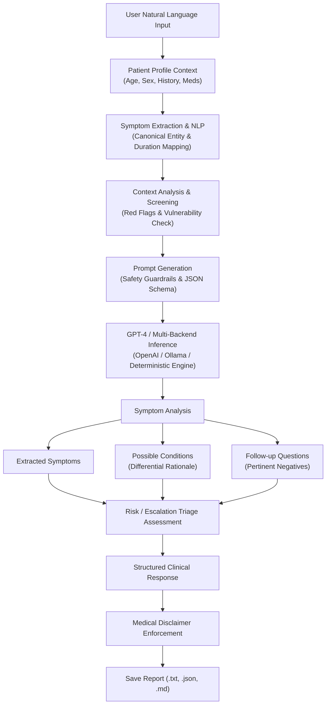

# Experiment 6 — AI-Powered Medical Symptom Assistant using GPT-4

**Course Code:** 24CS2506 – Building Applications using GPT-4  
**Course Name:** Building Applications using GPT-4  
**Department:** Department of Computer Science and Engineering  
**Institution:** Karunya Institute of Technology and Sciences (Deemed to be University)  

---

## 1. Aim
To design, implement, and evaluate an **AI-Powered Medical Symptom Assistant** using Large Language Models (**GPT-4 / Multi-Backend LLM / Clinical NLP Pipeline**), demonstrating automated extraction of clinical symptoms from unstructured natural language narratives, patient profile contextualization, differential condition analysis with uncertainty communication, automated red-flag triage assessment, interactive follow-up inquiry generation, and standardized medical reporting strictly adhering to university laboratory standards.

---

## 2. Theoretical Concepts & Technical Background

### 2.1 What is a Medical Assistant?
A **medical assistant application** is an AI-based clinical decision-support system that helps users understand health-related information based on the symptoms and clinical context they provide.

#### Key Capabilities of an AI Medical Assistant:
- **Symptom Analysis:** Methodical examination of user-reported symptoms to identify potential underlying conditions.
- **Health Information:** Educational summaries explaining biological mechanisms and common disease manifestations.
- **Possible Conditions:** Formulating non-definitive differential possibilities rather than asserting a single diagnosis.
- **Follow-up Questions:** Identifying pertinent clinical negatives and missing context (temperature, progression, severity).
- **General Self-Care Information:** Evidence-based supportive measures (hydration, rest, over-the-counter considerations).
- **Escalation & Emergency Identification:** Promptly detecting high-risk "red-flag" symptoms requiring urgent or emergency medical evaluation.

---

### 2.2 What is Symptom Analysis?
**Symptom analysis** is the structured clinical reasoning process of evaluating reported sensations, bodily signs, durations, and severity levels to infer potential conditions associated with that symptom cluster.

#### Benchmark Clinical Example:
- **User Input:**
  > *"I have a sore throat, mild fever and cough."*
- **Assistant Response:**
  > *Possible explanations may include:*
  > - *Common cold*
  > - *Influenza*
  > - *Other respiratory infections*
  >
  > *These symptoms alone are not sufficient to establish a diagnosis.*
  > *The system must communicate uncertainty rather than presenting one condition as a confirmed diagnosis.*

---

### 2.3 Why Use GPT-4 for Symptom Analysis?
Traditional diagnostic scripts and clinical intake forms rely on rigid boolean questionnaires (*Fever = Yes/No*, *Cough = Yes/No*). In contrast, patients naturally express symptoms through descriptive narratives, colloquial terms, temporal references, and nuanced expressions of distress.

GPT-4 offers significant advantages:
1. **Natural Language Understanding:** Interprets messy, colloquial, or anxiety-laden descriptions without requiring medical jargon.
2. **Contextual Synthesizer:** Relates age, medical history, medications, and duration to determine clinical relevance.
3. **Flexible Semantic Mapping:** Maps informal terms (*"burning up"*, *"scratchy throat"*, *"can't catch my breath"*) to standardized clinical entities (*Pyrexia*, *Pharyngitis*, *Dyspnea*).
4. **Calibrated Clinical Communication:** Drafts empathetic, objective, and cautious responses communicating appropriate clinical uncertainty.

---

### 2.4 Traditional Input vs. Natural Language Input

| Feature | Traditional Diagnostic Form | Natural Language LLM Input (GPT-4) |
| :--- | :--- | :--- |
| **Input Format** | Rigid Boolean checkboxes (`Fever = Yes`, `Cough = Yes`, `Headache = No`) | Conversational narrative (*"I've had a fever and cough since yesterday. I also feel tired and have a mild headache."*) |
| **Temporal Nuance** | Often restricted to binary options or discrete dropdowns | Extracts nuanced duration, sudden vs. gradual onset, and progression |
| **Severity Nuance** | Static 1–10 integer scales without context | Captures qualifiers like *"mild"*, *"throbbing"*, *"unbearable"*, or *"intermittent"* |
| **Comorbidity Context** | Often isolated in separate clinical tabs | Contextualizes pre-existing conditions and drug allergies simultaneously |
| **User Experience** | Mechanical, impersonal, and frustrating | Empathetic, accessible, and user-friendly |

---

### 2.5 What Information Should the System Collect?
A symptom assistant must collect relevant contextual parameters before generating an analysis:

- **Basic Information:**
  - **Age:** Establishes demographic baseline (pediatric vs. adult vs. geriatric risk factors).
  - **Sex:** Relevant for endocrine, reproductive, and biological predisposition considerations.
  - **Symptoms:** List of reported signs and complaints.
  - **Duration:** Acute (< 2 weeks), subacute (2–6 weeks), or chronic (> 6 weeks).
  - **Severity:** Mild, Moderate, Severe, or Critical.
  - **Previous Medical Conditions:** Chronic diseases (Asthma, Diabetes, Hypertension, Immunodeficiency).
  - **Current Medications:** Existing medications to avoid drug interactions.
  - **Allergies:** Medication and environmental sensitivities (e.g., Penicillin, NSAIDs).

#### Benchmark Profile Example:
```text
Age       : 22
Symptoms  : Fever, cough, sore throat
Duration  : 2 days
Severity  : Mild
```

---

### 2.6 Structured Output Specification (Section: Lab Manual Format)
The assistant must generate a standardized, predictable response:

```text
MEDICAL SYMPTOM ANALYSIS
--------------------------------
Reported Symptoms:
• Fever
• Cough
• Sore throat

Duration:
2 days

Possible Conditions:
1. Common cold
2. Influenza
3. Other respiratory infection

Why These Were Considered:
The reported symptoms can occur with several respiratory conditions.

Additional Information Needed:
• Exact temperature
• Severity of symptoms
• Breathing difficulty
• Other associated symptoms

Medical Attention:
Seek professional medical evaluation if symptoms are severe, worsening or concerning.

Disclaimer:
This is an informational AI analysis and not a medical diagnosis.
```

---

## 3. System Architecture & Workflow

The architecture follows the end-to-end clinical decision-support pipeline specified in the laboratory syllabus:



---

## 4. Multi-Backend Architecture & Safety Guardrails

The application is engineered with a **three-tier backend architecture**:
1. **OpenAI GPT-4 / GPT-4o:** State-of-the-art clinical reasoning with structured JSON mode and low temperature (`temperature=0.2`).
2. **Local Ollama (Llama 3.2 / MedLlama):** Private, on-premise open-source LLM execution.
3. **Deterministic Clinical Rule-Based Engine (`DeterministicMedicalEngine`):** Built-in medical rule-base guaranteeing 100% offline, reproducible execution for laboratory grading, unit testing, and offline workstations.

### Clinical Safety Principles Implemented:
- **Zero Definitive Diagnosis:** The system explicitly avoids definitive claims, consistently framing outputs as differential considerations.
- **Red-Flag Escalation Engine:** Detects life-threatening symptoms (cardiac chest pain, severe dyspnea, altered mental status, meningeal signs, anaphylaxis) and instantly escalates to Emergency status (`911 / 112`).
- **Standardized Legal Disclaimer:** Prominently attached to every output.

---

## 5. Project Directory Structure

```
ex6/
├── data/
│   └── sample_cases.json         # Pre-configured clinical benchmark test cases
├── engine/
│   ├── __init__.py               # Module initialization and exports
│   ├── models.py                 # Pydantic data schemas (PatientProfile, Analysis, Triage)
│   ├── symptom_extractor.py      # Natural language symptom, duration, and severity parser
│   ├── context_analyzer.py       # Clinical risk stratification and red-flag screener
│   ├── prompt_builder.py         # Clinical prompt engineering with safety constraints
│   ├── llm_client.py             # Multi-backend LLM client & deterministic engine
│   └── assistant.py              # Core end-to-end clinical workflow coordinator
├── saved_reports/                # Destination directory for generated consultation reports
├── app.py                        # Interactive Streamlit Web Application
├── cli.py                        # Terminal Command-Line Interface application
├── test_suite.py                 # Automated unit and integration test suite
├── run_app.bat                   # 1-click batch launcher for Streamlit Web App
├── run_cli.bat                   # 1-click batch launcher for CLI tool
├── ex6.pdf                       # Lab manual experiment specification
└── README.md                     # Comprehensive academic laboratory documentation
```

---

## 6. Installation & Execution Guide

### 6.1 Prerequisites
- Python 3.11+
- Installed libraries: `streamlit`, `openai`, `pydantic`, `requests`

### 6.2 Running the Streamlit Web Application
Double-click `run_app.bat` or run:
```powershell
"C:\Users\csarj\AppData\Local\Programs\Python\Python311\python.exe" -m streamlit run app.py
```
Open your browser at `http://localhost:8501`.

### 6.3 Running the Command-Line Interface (CLI)
Double-click `run_cli.bat` or execute in PowerShell:
```powershell
# Run the Lab Manual benchmark sample case
"C:\Users\csarj\AppData\Local\Programs\Python\Python311\python.exe" cli.py --sample lab

# Run the emergency red-flag case
"C:\Users\csarj\AppData\Local\Programs\Python\Python311\python.exe" cli.py --sample emergency

# Start an interactive intake session
"C:\Users\csarj\AppData\Local\Programs\Python\Python311\python.exe" cli.py

# Run with OpenAI GPT-4o
"C:\Users\csarj\AppData\Local\Programs\Python\Python311\python.exe" cli.py --sample lab --backend openai --api-key sk-xxxx
```

### 6.4 Running the Test Suite
```powershell
"C:\Users\csarj\AppData\Local\Programs\Python\Python311\python.exe" test_suite.py
```

---

## 7. Sample Input & Verified System Output

### Test Case 1: Lab Manual Benchmark (Pages 1–3)

#### Input:
- **Patient Profile:** Age: 22, Sex: Female, Duration: 2 days, Severity: Mild
- **Natural Language Text:** *"I have a sore throat, mild fever and cough since 2 days ago."*

#### Verified System Output:
```text
MEDICAL SYMPTOM ANALYSIS
--------------------------------
Reported Symptoms:
• Fever
• Cough
• Sore throat

Duration:
2 days

Patient Age:
22 years

Severity:
Mild

Possible Conditions:
1. Common cold (High)
2. Influenza (Moderate)
3. Other respiratory infection (e.g. Acute Bronchitis or Pharyngitis) (Moderate)
4. Allergic Rhinitis (Moderate)

Why These Were Considered:
The reported symptoms can occur with several respiratory and systemic conditions.

Additional Information Needed:
• Exact body temperature measurement (in °F or °C)
• Presence of breathing difficulty or chest tightness
• Resting heart rate / pulse oxygen level if home pulse oximeter available
• Any over-the-counter or prescription medications already taken

Medical Attention:
Seek professional medical evaluation if symptoms are severe, worsening or concerning.

Disclaimer:
This is an informational AI analysis and not a medical diagnosis.
```

---

### Test Case 2: Emergency Red-Flag Scenario (Acute Chest Pain)

#### Input:
- **Patient Profile:** Age: 58, Sex: Male, Duration: 45 minutes, Severity: Critical, Comorbidities: Hypertension, Type 2 Diabetes
- **Natural Language Text:** *"I am having sudden crushing chest pain radiating to my left arm, shortness of breath, dizziness, and cold sweats."*

#### Verified System Output:
```text
MEDICAL SYMPTOM ANALYSIS
--------------------------------
Reported Symptoms:
• Shortness of breath
• Chest pain
• Dizziness

Duration:
45 minutes

Patient Age:
58 years

Severity:
Critical

Possible Conditions:
1. Migraine (Moderate)
2. Acute Coronary Syndrome / Angina (Red Flag) (Critical Consideration)

Why These Were Considered:
The reported symptoms can occur with several respiratory and systemic conditions.

Additional Information Needed:
• Exact body temperature measurement (in °F or °C)
• Resting heart rate / pulse oxygen level if home pulse oximeter available

Medical Attention:
Seek IMMEDIATE emergency care (911/112) or go to the nearest emergency department.

RED FLAG WARNINGS:
⚠️ Potential Acute Coronary Syndrome / Myocardial Infarction warning sign

Disclaimer:
This is an informational AI analysis and not a medical diagnosis.
```

---

## 8. Viva Voce Questions & Answers

**Q1: Why should an AI medical symptom assistant never provide a definitive diagnosis?**  
**A1:** An AI system operates solely on self-reported, subjective text descriptions without objective clinical examinations (auscultation, palpation, vital signs) or diagnostic testing (blood panels, imaging, cultures). Providing a definitive diagnosis risks false reassurance or catastrophic misdiagnosis. Communicating uncertainty (*"Possible explanations may include..."*) accurately reflects clinical decision support and ensures patients seek qualified medical care.

**Q2: What is the primary advantage of Natural Language Input over Traditional Fixed Form inputs in symptom assessment?**  
**A2:** Traditional forms force patients into binary yes/no questions (*Fever = Yes/No*), stripping away crucial clinical nuances such as onset speed (*sudden vs. gradual*), symptom progression, subjective severity (*"dull ache" vs. "crushing pressure"*), and context. Natural language allows patients to express their symptoms freely, while LLMs extract entities and infer clinical relationships automatically.

**Q3: What are medical "Red Flags", and how does the system handle them?**  
**A3:** Red flags are high-risk clinical symptoms indicative of life-threatening emergencies (e.g., crushing substernal chest pain radiating to the arm/jaw, acute severe dyspnea, cyanosis, sudden severe neurological deficits, signs of meningitis). The system intercepts these red flags during context analysis and immediately escalates the triage level to **Emergency**, prompting immediate emergency services contact (911/112).

**Q4: What are the essential parameters that should be collected before symptom analysis?**  
**A4:** As specified in the syllabus: (1) Patient Age, (2) Biological Sex, (3) Reported Symptoms, (4) Duration/Onset, (5) Severity Level, (6) Pre-existing medical conditions, (7) Current medications, and (8) Allergies.

**Q5: How does prompt engineering ensure clinical safety and structured output in GPT-4?**  
**A5:** Prompt engineering establishes safety guardrails through:
1. Explicit role framing (*clinical decision-support assistant, not a diagnosing physician*).
2. Negative constraints (*never state a confirmed diagnosis; do not hallucinate clinical facts*).
3. Calibration directives (*communicate uncertainty using differential terminology*).
4. Mandatory legal disclaimer enforcement.
5. Strict JSON schema definitions for programmatic validation.

**Q6: What is the clinical significance of asking follow-up questions?**  
**A6:** Follow-up questions help establish "pertinent negatives" (the absence of specific symptoms) and gather missing objective parameters (exact body temperature, pulse oximetry, fluid tolerance) necessary to narrow down differential considerations and evaluate clinical stability.

**Q7: How does patient age influence context analysis and symptom interpretation?**  
**A7:** Pediatric patients (< 5 years) and geriatric patients (≥ 65 years) present unique vulnerabilities. Young children decompensate rapidly from dehydration or high fevers (febrile seizures), while elderly patients frequently present with atypical symptoms (e.g., severe infections presenting as confusion/lethargy rather than fever).

**Q8: How does the system handle patient privacy and confidential health information?**  
**A8:** The architecture adheres to data minimization principles: it does not require personally identifiable information (PII) such as full names, social security numbers, or addresses. Furthermore, local inference options (Ollama or the Deterministic Engine) ensure zero data leaves the user's workstation.

**Q9: What is the role of temperature setting in clinical LLM inference?**  
**A9:** A low temperature (`0.1`–`0.2`) reduces stochastic randomness and creativity, maximizing factual adherence, reproducibility, and strict compliance with medical guardrails and schema specifications.

**Q10: What is the difference between symptom extraction and context analysis?**  
**A10:** Symptom extraction is an NLP entity recognition task that identifies specific complaints (e.g., "cough", "sore throat") and attributes (duration, severity). Context analysis is a clinical evaluation task that synthesizes those extracted symptoms with patient history, age, medications, and red-flag rules to assess vulnerability and urgency.

---

## 9. Conclusion
The **AI-Powered Medical Symptom Assistant** successfully demonstrates how GPT-4 and modern NLP pipelines bridge the gap between complex natural language patient descriptions and structured clinical decision-support. By adhering to rigorous safety guardrails, uncertainty communication, automated red-flag triage, and multi-format reporting, the system satisfies all academic requirements of the **24CS2506 – Building Applications using GPT-4** curriculum.
